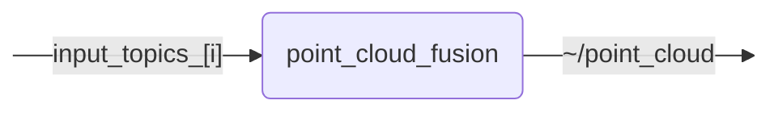

# `point_cloud_fusion`

Fuses multiple point clouds into a single point cloud with common target frame.

## Nodes

### `point_cloud_fusion`

Subscribes to the point-cloud topics configured in `input_topics`, transforms
them into `target_frame`, and publishes one fused point cloud. The input and
output use `point_cloud_transport`, allowing transport plugins to be selected
through the node parameters.



#### Subscribed Topics

| Topic | Type | Description |
| --- | --- | --- |
| `input_topics_[i]` | `sensor_msgs/msg/PointCloud2` | Point-cloud topics to fuse |

#### Published Topics

| Topic | Type | Description |
| --- | --- | --- |
| `~/point_cloud` | `sensor_msgs/msg/PointCloud2` | Output topic for the fused point cloud |

#### Parameters

| Parameter | Type | Default | Description |
| --- | --- | --- | --- |
| `target_frame` | `string` | `"base_link"` | Frame into which all input point clouds are transformed before fusion |
| `input_topics` | `string[]` | `[]` | Point-cloud topics to fuse |
| `input_transport_hints` | `string[]` | `[]` | Transport hint for each input topic; unspecified entries use raw |
| `sync_mode` | `string` | `"approximate"` | Synchronization policy: approximate or partial |
| `partial_sync.publish_rate_hz` | `float` | `0.0` | Maximum publication rate in partial mode [Hz]; must be positive |
| `partial_sync.timeout_sec` | `float` | `0.01` | Collection wait after the first pending cloud [s] |
| `partial_sync.max_age_sec` | `float` | `0.2` | Maximum measurement age or future timestamp offset [s]; must be positive and at least `timeout_sec` |
| `sync_queue_size` | `int` | `3` | Input queue depth in approximate mode |
| `output_queue_size` | `int` | `10` | Queue depth for the fused output publisher |
| `output_fields` | `string[]` | `[]` | Fields retained in the fused output; an empty list retains all input fields |
| `output_stamp_mode` | `string` | `"earliest"` | Fused timestamp selection: earliest, latest, mean, or input0; input0 requires approximate mode |
| `fixed_points_per_input_cloud` | `int` | `0` | Runtime-reconfigurable maximum valid point count per input cloud; 0 disables the limit |
| `use_cuda` | `bool` | `true` | Runtime-reconfigurable backend selection; true uses CUDA and false uses CPU |
| `motion_compensation.enable` | `bool` | `false` | Compensate inter-sensor capture skew and motion during each scan |
| `motion_compensation.fixed_frame` | `string` | `"map"` | World-fixed TF frame used to compare sensor poses at different times |
| `motion_compensation.time_field` | `string` | `"t"` | UINT32 point field containing an offset from the cloud header stamp |
| `motion_compensation.time_scale_sec` | `float` | `1.0e-9` | Seconds represented by one unit of the per-point time field |
| `motion_compensation.tf_timeout_sec` | `float` | `0.1` | Timeout for the first motion-compensation TF failure [s] |
| `range_limits.enable` | `bool` | `false` | Enable XYZ range filtering after transformation into target_frame |
| `range_limits.x_min` | `float` | `-1000.0` | Minimum x coordinate in target_frame to keep [m] |
| `range_limits.x_max` | `float` | `1000.0` | Maximum x coordinate in target_frame to keep [m] |
| `range_limits.y_min` | `float` | `-1000.0` | Minimum y coordinate in target_frame to keep [m] |
| `range_limits.y_max` | `float` | `1000.0` | Maximum y coordinate in target_frame to keep [m] |
| `range_limits.z_min` | `float` | `-20.0` | Minimum z coordinate in target_frame to keep [m] |
| `range_limits.z_max` | `float` | `20.0` | Maximum z coordinate in target_frame to keep [m] |
| `max_time_diff_sec` | `float` | `0.05` | Maximum timestamp spread across a synchronized input batch in seconds |
| `age_penalty` | `float` | `0.1` | Age penalty used by the approximate-time synchronizer |

#### Synchronization

In `approximate` mode, each batch requires a timestamp-matched cloud from every
configured input. The slowest input limits the output rate. A single input is
processed directly.

In `partial` mode, the first cloud starts a collection window of
`partial_sync.timeout_sec`. The available inputs are then fused, subject to
`partial_sync.publish_rate_hz`. While waiting, each topic retains its newest cloud.
The batch is anchored at the newest timestamp and must fit `max_time_diff_sec`.
Selected scans are consumed once; stale, duplicate, and older unmatched scans are
discarded. Empty batches are not published.

Example configuration for sensors with different rates or missing scans:

```yaml
/**:
  ros__parameters:
    sync_mode: partial
    partial_sync:
      publish_rate_hz: 20.0
      timeout_sec: 0.01
      max_age_sec: 0.2
    max_time_diff_sec: 0.01
    output_stamp_mode: earliest
```

Partial mode requires input timestamps synchronized with the node's ROS clock.
Collection, freshness checks, and rate limiting follow that clock, including
`use_sim_time`. Backwards clock jumps clear pending data and timestamp history.
Choose the collection timeout to cover delivery skew and the maximum age to cover
acceptable measurement latency, including collection and rate-limit delays.

Partial subscriptions use sensor-data QoS (best effort); approximate subscriptions
use default QoS (reliable). Synchronization parameters are set at startup.

## Launch Files

### [`point_cloud_fusion.launch.py`](launch/point_cloud_fusion.launch.py)

| Argument | Default | Description |
| --- | --- | --- |
| `point_cloud_topic` | `"~/point_cloud"` | Output topic for the fused point cloud |
| `name` | `"point_cloud_fusion"` | Node name. |
| `namespace` | `""` | Node namespace. |
| `params` | `os.path.join(get_package_share_directory("point_cloud_fusion"), "config", "params.yml")` | Path to the parameter file. |
| `log_level` | `"info"` | ROS logging level (debug, info, warn, error, fatal) |
| `use_sim_time` | `"false"` | Use the simulation clock. |
| `ros_tracing` | `"false"` | Enable ROS tracing. |
